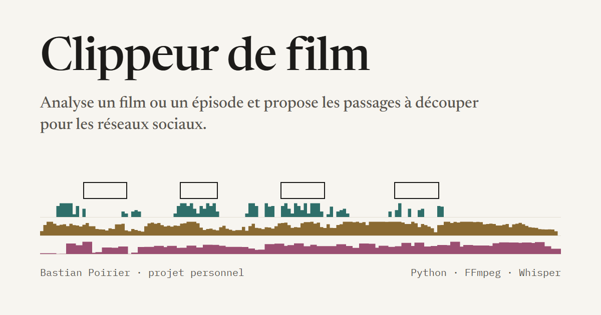

# Clippeur de film

Un programme qui analyse un film ou un épisode de série et propose les passages à découper en clips pour les réseaux sociaux, d'une minute par défaut. Il tourne en local sur un PC Windows, sans carte graphique, et n'utilise aucun service payant.

[Présentation du projet](https://bastianpoirier.github.io/clippeur-de-film/) · [Démo en ligne](https://bastianpoirier.github.io/clippeur-de-film/demo/) · [Cahier des charges](CAHIER_DES_CHARGES.md)



## Ce que fait le programme

On lui donne un fichier vidéo. Il identifie l'œuvre à partir du nom du fichier (fiche Wikipédia et Wikidata), lit les sous-titres ou transcrit les dialogues avec Whisper, cherche les répliques célèbres sur Wikiquote et les retrouve dans les dialogues. En parallèle, il mesure le volume, repère les changements de plan avec FFmpeg et reconnaît les rires, cris, explosions et la musique avec un petit modèle audio (AST) exécuté en local.

Chaque fenêtre de la longueur choisie (30 s, 45 s, 1 min, 1 min 30 ou 2 min ; 1 min par défaut) reçoit ensuite une note :

```
note  = 0,6 × citations + 0,4 × local
local = 0,35 × dialogues + 0,25 × volume + 0,25 × sons + 0,15 × exclamations
```

Les meilleures fenêtres sont gardées sans chevauchement, commencent et finissent sur une réplique entière, et sont calées sur le changement de plan le plus proche. Chaque extrait proposé indique pourquoi il a été retenu. L'export se fait en MP4, au format d'origine ou en vertical 9:16, avec le son ramené à −14 LUFS.

## Droits d'auteur

Le programme sert à repérer et découper des passages, pas à les publier. Je ne l'ai jamais utilisé pour publier quoi que ce soit : sans les droits sur les films, ce n'était pas possible légalement.

Il accepte n'importe quel fichier vidéo : un film, mais aussi une vidéo YouTube sous licence Creative Commons ou la rediffusion d'un live Twitch qu'on a le droit de réutiliser. Les extraits produits ne sont publiables que si l'on a les droits sur la vidéo d'origine.

La démo en ligne utilise uniquement des films libres de la Blender Foundation (voir [Crédits](#crédits)).

## Installation

Il faut Windows, [Python 3.12](https://www.python.org/downloads/) et [FFmpeg](https://ffmpeg.org/download.html) accessible dans le `PATH`.

```powershell
git clone https://github.com/bastianpoirier/clippeur-de-film
cd clippeur-de-film
python -m venv .venv
.\.venv\Scripts\python.exe -m pip install -r requirements.txt
```

Aucun compte ni clé n'est nécessaire. Au premier usage, l'application télécharge le modèle Whisper (environ 500 Mo, seulement si une vidéo n'a pas de sous-titres) et le modèle de reconnaissance des sons (environ 90 Mo).

Une clé [TMDb](https://www.themoviedb.org/settings/api) est facultative : collée dans la page (« Utiliser TMDb à la place »), elle donne une fiche plus complète. Elle est enregistrée dans `.env`, exclu de Git.

## Utilisation

### Interface

Double-cliquer sur `lancer.bat`, ou :

```powershell
.\.venv\Scripts\python.exe -m clippeur interface
```

La page s'ouvre sur http://127.0.0.1:5000. « Choisir un film » ouvre la fenêtre Windows de choix de fichier ; la vidéo est lue là où elle est, sans être copiée. Ensuite tout s'enchaîne : identification, transcription, citations, puis proposition des extraits. On peut corriger l'identification, cocher les citations qui comptent, choisir la durée des extraits, regarder un aperçu de chaque extrait, ajuster son début et sa fin, choisir le format et une musique de fond, puis exporter. Les fichiers arrivent dans `output/<film>/`, avec un récapitulatif `extraits.json`.

La page propose aussi :

- un traitement automatique : toute vidéo déposée dans `a_traiter/` (si la surveillance est activée), ou toute une saison choisie d'un coup, est traitée seule jusqu'à l'export. Pour une saison, `output/saisons/<saison>.json` rassemble les 10 meilleurs extraits ;
- une banque de musiques de fond : les morceaux se déposent dans `musiques/` et restent sur le PC.

### Ligne de commande

```powershell
.\.venv\Scripts\python.exe -m clippeur transcrire "C:\films\film.mkv"
.\.venv\Scripts\python.exe -m clippeur rechercher "C:\films\film.mkv"
.\.venv\Scripts\python.exe -m clippeur extraits "C:\films\film.mkv" --nombre 10 --exporter
```

| Commande | Options |
|---|---|
| `transcrire` | `--langue fr\|en` (fr par défaut), `--modele tiny\|base\|small\|medium` (small par défaut), `--forcer` pour refaire une transcription en cache |
| `rechercher` | `--langue`, `--page` pour imposer une page Wikiquote |
| `extraits` | `--langue`, `--nombre` (10 par défaut), `--duree 30\|45\|60\|90\|120` en secondes (60 par défaut), `--exporter` pour écrire les MP4 |
| `interface` | `--port` (5000 par défaut), `--sans-navigateur` |

Pour les dialogues, l'application prend dans l'ordre : un fichier de sous-titres placé à côté de la vidéo (`film.srt`, `film.en.srt`…), une piste de sous-titres intégrée au fichier, sinon la transcription Whisper sur le processeur. Les résultats intermédiaires sont gardés dans `cache/<film>/` : une relance les relit au lieu de tout refaire.

## Organisation du dépôt

| Chemin | Contenu |
|---|---|
| `clippeur/` | L'application : un module par étape (`transcription.py`, `recherche.py`, `sons.py`, `selection.py`, `export.py`…), la page locale (`web.py`, `templates/index.html`) et la file d'attente |
| `tests/` | Tests automatisés (pytest) |
| `index.html`, `assets/` | Page de présentation publiée sur GitHub Pages, ses couleurs (`tokens.css`), les mesures de la figure (`frise.js`) et l'image d'aperçu des partages |
| `demo/` | Démo en ligne : la page de l'application, une simulation du serveur (`simulation.js`), les résultats précalculés (`donnees.js`), les images des extraits et une copie 480p de *Tears of Steel* |
| `outils/` | `construire_demo.py`, qui régénère la démo, et `apercu.html`, la source de l'image d'aperçu |
| `CAHIER_DES_CHARGES.md` | Exigences et choix techniques |

`a_traiter/`, `cache/`, `output/` et le contenu de `musiques/` restent sur le PC : ils sont exclus de Git.

## Démo en ligne

Un navigateur ne peut ni faire tourner Python ni lire un film de plusieurs Go. La démo reprend donc la vraie page de l'application, et `demo/simulation.js` répond à la place du serveur avec des résultats que l'application a réellement calculés. Elle s'ouvre avec *Tears of Steel* déjà analysé ; choisir un autre film rejoue l'analyse en accéléré.

Pour la régénérer après une modification de l'application :

```powershell
.\.venv\Scripts\python.exe outils\construire_demo.py "C:\films\Tears of Steel (2012).mov" "C:\films\Sintel (2010).mkv" "C:\films\Cosmos Laundromat (2015).mp4"
```

Le premier film sert aussi à la figure de la page de présentation.

## Tests

```powershell
.\.venv\Scripts\python.exe -m pytest
```

## Crédits

Films utilisés par la démo et la page de présentation, sous licence Creative Commons BY, © Blender Foundation :

- *Tears of Steel* (2012), [mango.blender.org](https://mango.blender.org), CC BY 3.0
- *Sintel* (2010), [durian.blender.org](https://durian.blender.org), CC BY 3.0
- *Cosmos Laundromat* (2015), [gooseberry.blender.org](https://gooseberry.blender.org), CC BY 4.0

Données : Wikipédia, Wikidata et Wikiquote. Reconnaissance des sons : modèle AST entraîné sur AudioSet ; transcription : [faster-whisper](https://github.com/SYSTRAN/faster-whisper).
